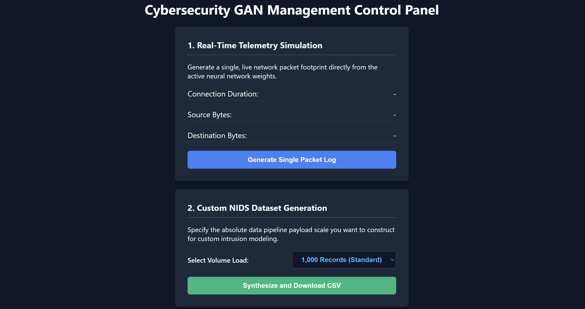
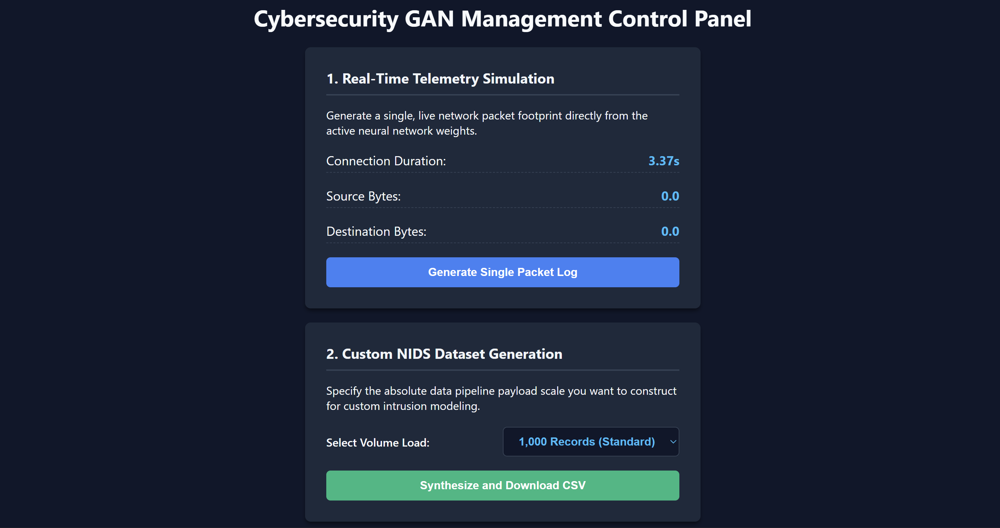
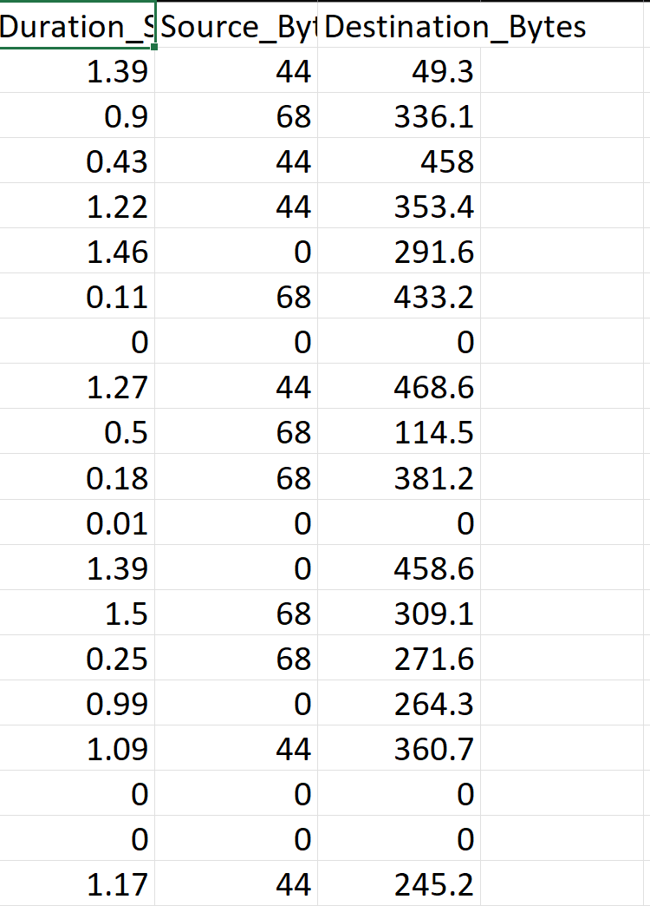

# GAN Network Traffic Generator 🌐📊

An end-to-end deep learning project utilizing Generative Adversarial Networks (GANs) to model and generate synthetic network traffic data for analysis, testing, and security research.

## ✨ Features
* 🧠 **Deep Learning GAN Architecture** — Trains generator and discriminator networks on tabular network traffic datasets to produce realistic synthetic logs.
* 📈 **Synthetic Data Generation** — Generates and exports randomized or targeted network flows to `live_generated_traffic.csv` for downstream security testing and anomaly detection.
* 💻 **Interactive Web Interface** — Features a clean, modern web interface built with a Flask backend allowing users to trigger generation and inspect traffic metrics in real-time.
* ⚙️ **Robust Scaler & Model Serialization** — Incorporates automated feature scaling (`scaler.pkl`) and PyTorch model weights (`tabular_traffic_generator.pth`) for seamless inference.

## 📸 Screenshots

### 🖥️ Dashboard & Real-Time Traffic View


### 📊 Network Traffic Analytics & Generation Panel


### 📊 Network Traffic Analytics Result CSV


## 🛠️ Tech Stack

### Frontend & UI
HTML • JavaScript • CSS • Responsive Layout

### Backend
Python • Flask

### Deep Learning & Processing
PyTorch • Pandas • Scikit-Learn • Jupyter Notebooks

## 🏗️ Architecture
```text
                 ┌─────────────────────┐
                 │    Web Interface    │
                 │   HTML / JavaScript │
                 └──────────┬──────────┘
                            │
                      HTTP Request
                            │
                            ▼
                 ┌─────────────────────┐
                 │    Flask Server     │
                 │     Python Backend  │
                 └──────────┬──────────┘
                            │
                            ▼
                 ┌─────────────────────┐
                 │ PyTorch GAN Model   │
                 └─────────────────────┘

```

## ⚙️ Requirements

Before running the application, make sure you have installed:

* Python 3.8 or higher
* Git
* PyTorch & Scikit-Learn

## 🚀 Installation

1. **Clone the repository**
```bash
git clone [https://github.com/YakeshKrishnanD/Gan-network-traffic-generator.git](https://github.com/YakeshKrishnanD/Gan-network-traffic-generator.git)
cd Gan-network-traffic-generator

```


2. **Install dependencies**
```bash
pip install torch pandas scikit-learn flask

```


3. **Run the Application**
```bash
python app.py

```


4. **Access the Web App**
Open your web browser and navigate to the local server address:
`http://127.0.0.1:5000`

## 💡 How to Use

1. **Dashboard Interface**: Navigate through the web app to view system controls and traffic generation options.
2. **Generate Traffic**: Trigger synthetic network traffic generation and view exported logs directly via `live_generated_traffic.csv`.

## 📌 Future Improvements

* Advanced anomaly detection visualization dashboards
* Automated evaluation metrics (FID score / distribution plots)
* Support for customizable neural network hyperparameters via UI
* Real-time packet capture integration

## 👨‍💻 Author

Yakesh Krishnan D

GAN Network Traffic Generator — Deep learning-based synthetic network traffic modeling and generation tool.

⭐ If you find this project useful, consider giving the repository a star.


GAN Network Traffic Generator — Deep learning-based synthetic network traffic modeling and generation tool.

⭐ If you find this project useful, consider giving the repository a star.
